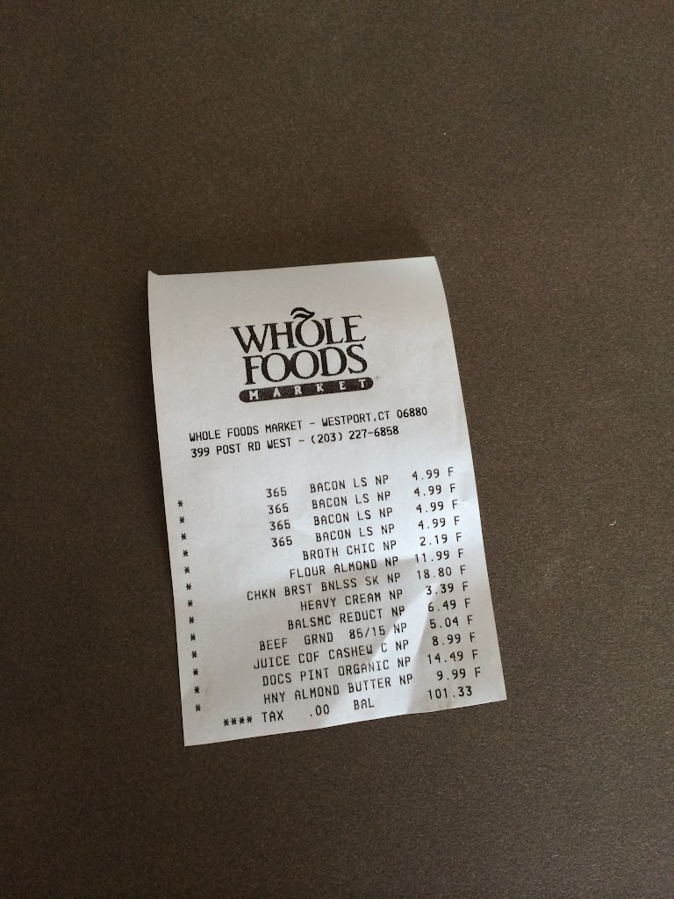
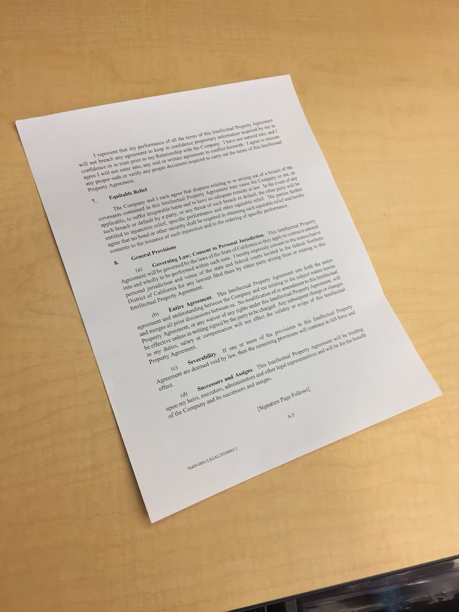
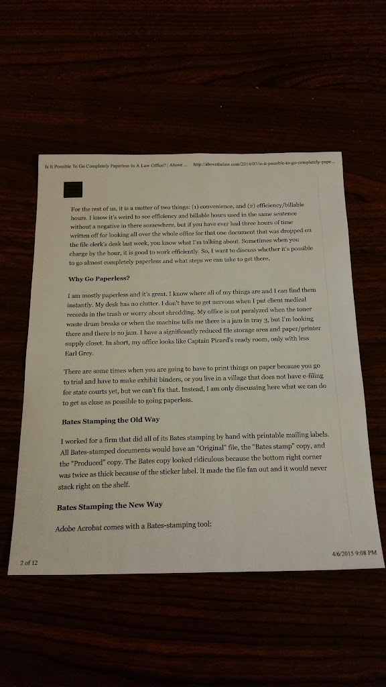
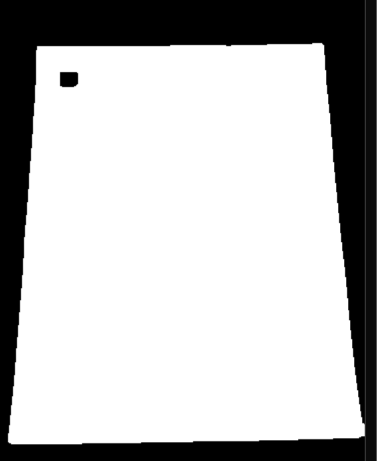
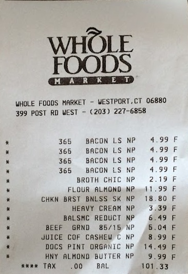
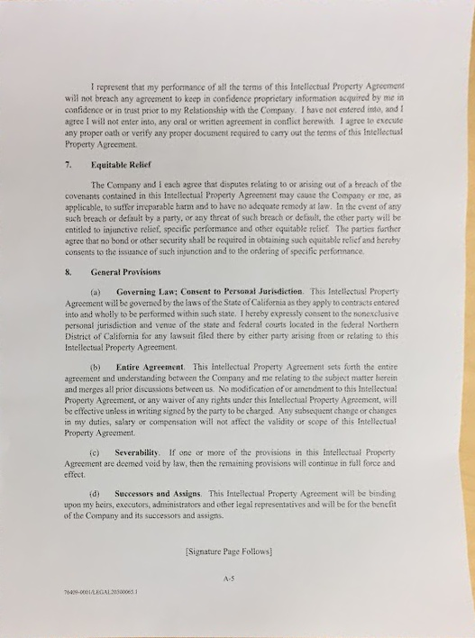
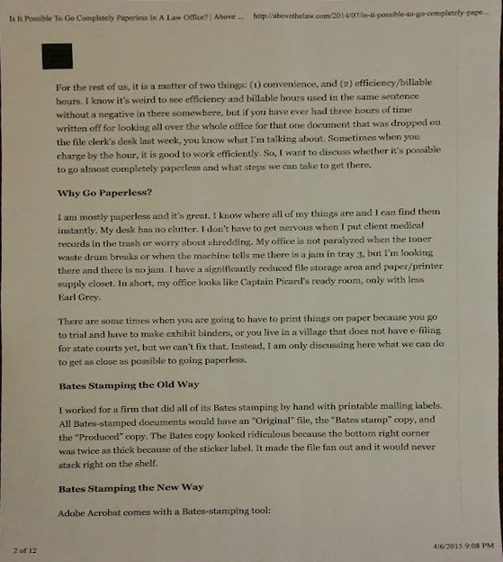

# Devoir 2 (Code) : Redressement d'une page par transformation de perspective

**Langage / bibliothèque :** C++ avec OpenCV (développé sous Code::Blocks)

## Objectif

À partir de la photo d'une page posée sur un fond, le programme (`devoir2.cpp`) :

1. détecte automatiquement les 4 coins du document ;
2. affiche le résultat de cette détection ;
3. permet d'ajuster les points à la souris ;
4. applique la transformation de perspective pour obtenir une vue de dessus.

Il gère deux types d'images : fond simple (uniforme et contrasté) et fond texturé.

## Images de test

Le programme a été testé avec exactement les 3 images fournies par le professeur
sur Google Classroom, sans aucune modification :

| Image | Contenu | Type de fond |
|---|---|---|
| `receipt.jpg` | ticket de caisse sur fond sombre uniforme | simple |
| `desk.JPG` | page sur un bureau en bois clair | texturé clair |
| `cell_pic.jpg` | page sur une table en bois sombre | texturé mais très contrasté (traité comme simple) |

Par défaut, le programme traite ces 3 images dans cet ordre. D'autres images
peuvent être données en arguments de la ligne de commande.

## Compilation et exécution

- Projet Code::Blocks avec OpenCV configuré (includes, bibliothèques) et le standard C++11 ou supérieur.
- Placer les images dans le dossier de travail de l'exécutable.
- Lancer le programme : les 3 images sont traitées l'une après l'autre.

Avec d'autres images : `programme.exe chemin/image1.jpg chemin/image2.jpg`

## Commandes

| Action | Effet |
|---|---|
| Glisser un point à la souris | ajuster un coin |
| `Entrée` ou `Espace` | valider et appliquer la transformation |
| `m` | changer de méthode (simple / texturée) |
| `r` | relancer la détection avec la méthode courante |
| `Échap` | quitter (pendant l'ajustement) |

Pour chaque image, le programme enregistre :
`detection_<nom>` (coins ajustés), `masque_<nom>` (masque binaire) et `resultat_<nom>` (image redressée).

## Méthodes et justification

### Fond simple ou texturé très contrasté (`receipt.jpg`, `cell_pic.jpg`)

La page est nettement plus claire que le fond, donc l'histogramme de luminosité
est bimodal. Le **seuillage d'Otsu** sur l'image en niveaux de gris sépare la
page du fond sans paramètre à régler. La méthode est simple et rapide.

Pour `cell_pic.jpg`, le bois est texturé mais sa luminosité est bien plus basse
que celle du papier : l'histogramme reste bimodal et Otsu suffit, la saturation
n'est pas nécessaire.

### Fond texturé clair (`desk.JPG`)

La luminosité du bois clair est proche de celle du papier : Otsu seul déborde
sur le fond. On y ajoute un **seuillage d'Otsu sur la saturation** (espace HSV).
Le papier est blanc (peu saturé) alors que le bois est coloré. Les deux masques
sont combinés par un ET logique.

### Étapes communes

1. Flou gaussien (réduit le bruit et la texture)
2. Ouverture puis fermeture morphologique (supprime le bruit, comble le texte de la page)
3. Plus grand contour extérieur, puis enveloppe convexe
4. `approxPolyDP` avec tolérance croissante pour obtenir 4 sommets (`minAreaRect` en secours)
5. Ordre des coins : haut-gauche, haut-droite, bas-droite, bas-gauche
6. `getPerspectiveTransform` et `warpPerspective` sur l'image d'origine en pleine résolution

### Choix automatique de la méthode

Le programme essaie d'abord la méthode simple. Si son masque touche plus de 10 %
du cadre de l'image, le fond ressemble à la page et la méthode simple a échoué :
il bascule alors sur la méthode texturée. Le seuil de 10 % a été choisi d'après
les mesures ci-dessous, qui laissent une large marge.

| Image | Débordement du masque | Méthode choisie |
|---|---|---|
| `receipt.jpg` | 0 | simple |
| `cell_pic.jpg` | 0.006 | simple |
| `desk.JPG` | 0.239 | texturée |

La touche `m` permet de corriger ce choix manuellement.

## Limites

- La méthode texturée suppose un papier blanc (peu saturé) et un fond coloré.
  Elle échoue sur un fond gris/blanc texturé ou un papier coloré.
- Le tri des coins (somme/différence) est fiable pour une page peu inclinée,
  moins pour une rotation proche de 45°.
- Dans ces cas, l'ajustement manuel (souris, touche `m`) permet de corriger.
- Pistes d'amélioration : Canny + Hough (intersection des 4 bords) ou GrabCut.

## Résultats

### Détection automatique (avant ajustement manuel)

| `receipt.jpg` | `desk.JPG` | `cell_pic.jpg` |
|---|---|---|
|  |  |  |

### Masques binaires

| `receipt.jpg` | `desk.JPG` | `cell_pic.jpg` |
|---|---|---|
|  |  |  |

### Images redressées (vue de dessus)

| `resultat_receipt.jpg` | `resultat_desk.JPG` | `resultat_cell_pic.jpg` |
|---|---|---|
|  |  |  |
